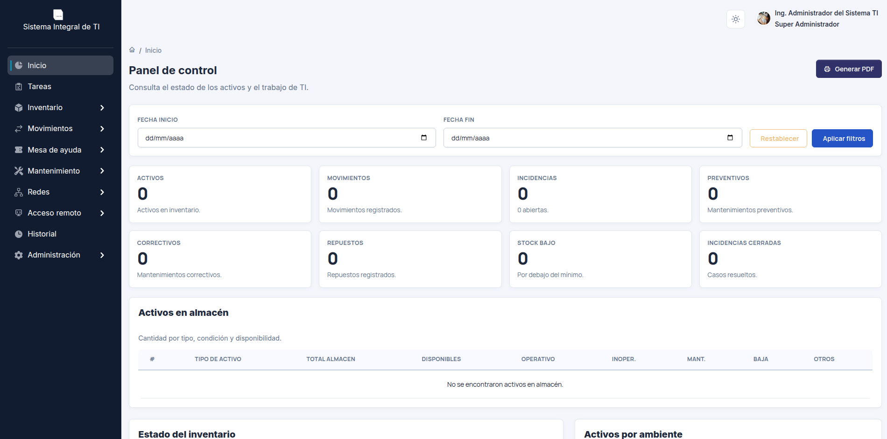

# Sistema Integral de TI

Es un sistema web para administrar los recursos y las operaciones de TI (Tecnologías de la Información).



## Descripción

Este sistema web es de código abierto que permite administrar activos, registrar tareas, atender incidencias y dar seguimiento a movimientos y mantenimientos. Incluye roles y permisos para controlar el acceso a los módulos y las acciones de cada usuario.

## Funciones principales

- **Panel de control:** consulta indicadores y genera reportes PDF.
- **Tareas:** registra encargos, prioridades, fechas límite y avances.
- **Inventario:** administra activos y genera etiquetas QR para su consulta rápida.
- **Movimientos:** registra asignaciones, traslados, préstamos y devoluciones.
- **Mesa de ayuda:** registra incidencias y da seguimiento a su diagnóstico, solución y cierre.
- **Mantenimiento:** programa trabajos preventivos, registra reparaciones y controla repuestos.
- **Redes:** gestiona redes Wi-Fi, organiza segmentos de red y controla la asignación de direcciones IP.
- **Acceso remoto:** organiza los accesos vinculados a cada equipo.
- **Historial:** consulta los movimientos, incidencias y mantenimientos de cada activo.
- **Administración:** gestiona empleados, usuarios, roles, permisos y parámetros del sistema.

## Tecnologías

PHP con MVC propio, MySQL 8, JavaScript, jQuery, Bootstrap, DataTables, TCPDF, FPDF y Docker Compose.

## Instalación local

Requiere Docker con Docker Compose.

1. Copiar la configuración y definir contraseñas propias:

   ```bash
   cp .env.example .env
   ```

2. Elegir puertos libres en `.env` si los predeterminados están ocupados:

   ```dotenv
   WEB_PORT=8080
   PHPMYADMIN_PORT=8081
   MYSQL_PORT=3308
   ```

   `APP_URL` es opcional; vacía utiliza `http://localhost:<WEB_PORT>`. Para otro dominio, indicar la URL completa.

3. Iniciar los servicios y esperar a que MySQL esté listo:

   ```bash
   docker compose up -d --build
   docker compose logs db
   ```

4. Importar la estructura y los datos iniciales **solo en una base nueva y vacía**:

   ```bash
   docker compose exec -T db sh -c 'MYSQL_PWD="$MYSQL_ROOT_PASSWORD" mysql -u root "$MYSQL_DATABASE"' < app/Database/tablas.sql
   docker compose exec -T db sh -c 'MYSQL_PWD="$MYSQL_ROOT_PASSWORD" mysql -u root "$MYSQL_DATABASE"' < app/Database/datos.sql
   ```

5. Abrir la aplicación e iniciar sesión con `super` / `super`. Cambiar esta contraseña antes de usar datos reales y configurar los permisos de los demás roles.

| Servicio | Dirección predeterminada |
| --- | --- |
| Aplicación | http://localhost:8080 |
| phpMyAdmin | http://localhost:8081 |
| MySQL | `localhost:3308` |

Después de cambiar puertos o URL, ejecutar `docker compose up -d --build`. Las credenciales iniciales de MySQL solo se aplican al crear el volumen; cambiarlas en `.env` no actualiza las cuentas existentes.

Para detener el entorno conservando los datos: `docker compose down`.

## Despliegue

Para publicar el sistema en un servidor, define su dirección en `APP_URL`, habilita HTTPS y restringe el acceso a MySQL, phpMyAdmin y los archivos adjuntos.

## Desarrollo

El proyecto se desarrolló durante años sin inteligencia artificial. Posteriormente, se incorporó IA como herramienta de apoyo para completar el desarrollo del sistema.

## Colaboración

Reportar errores o proponer mejoras mediante los issues del repositorio. Mantener el estilo global y los permisos del sistema. No incluir credenciales ni datos de instalaciones reales.

## Licencia y créditos

El código propio se distribuye bajo [MIT](LICENSE). Los componentes de terceros conservan sus licencias y avisos.

La interfaz toma como base [Volt de Themesberg](https://github.com/themesberg/volt-bootstrap-5-dashboard), con cambios propios de diseño y funcionamiento.

## Contacto

Ismael Injante — [LinkedIn](https://www.linkedin.com/in/20ismael1999/)